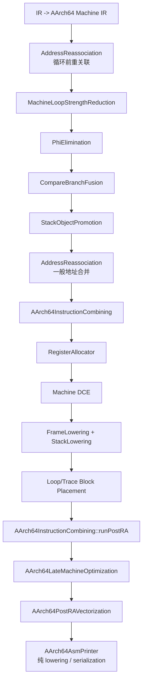

# 编译系统分析、设计及实现文档

> 文档基线：`zct-arm-no-magic` 分支，提交 `46351fd475a5009f61e3edcdef806e0f534d3808`（2026-08-03）
>
> 实现语言：C++17
>
> 输入语言：SysY2022/SysY2026 子集
>
> 输出目标：RISC-V 64 与 AArch64；当前竞赛正式优化目标为 AArch64/Cortex-A53
>
> 本文以当前源码和实际流水线为准。源码存在但未接入默认 `-O1` 的 pass、已回退实验以及仍需继续演进的设计限制均单独标注。

## 1. 文档目的与范围

本文系统说明本仓库编译器的需求、总体架构、模块边界、核心数据结构、前后端实现、优化策略、正确性保证、测试评测流程及已知局限。重点不是只罗列 pass 名称，而是解释每类优化识别什么程序语义、依赖哪些分析、执行什么变换、如何保留 fallback，以及为什么能够保持程序语义。

本文覆盖：

- 命令行驱动、文件读写和诊断；
- 词法、语法、AST、语义分析、类型检查和 AST 到 IR 降级；
- 自定义 SSA 风格 IR、验证器、中端 pass 管理和过程间效果分析；
- 当前 `-O1` 流水线内的全部优化；
- 已实现但未接入默认流水线的优化；
- RISC-V 64 与 AArch64 Machine IR、指令选择、寄存器分配、栈帧和汇编输出；
- AArch64 NEON、矩阵、递归记忆化、循环闭式化等专项但结构化的激进优化；
- 合规边界、已完成的结构化后端迁移、验证门禁和后续泛化方向。

## 2. 需求分析与设计目标

### 2.1 功能需求

编译器接收单个 SysY 源文件，完成完整编译并输出 GNU 汇编。主要命令形式为：

```bash
/workspace/build/compiler -S -O1 --target aarch64 -o output.s input.sy
```

当前命令行支持：

- `-S`：输出汇编；
- `-O1`：启用中端优化；
- `--target riscv64|aarch64|arm64`：选择目标；
- `-o <path>`：指定输出文件；
- `--dump-tokens`、`--dump-ast`、`--dump-ir`：输出中间阶段，便于调试。

### 2.2 非功能需求

1. **正确性优先**：每项变换必须对所有满足前置条件的输入保持语义等价，不能依赖未定义行为或公开数据范围。
2. **双目标复用**：前端和大部分中端优化共享，目标相关逻辑放在后端或显式 AArch64 pass 中。
3. **可回退**：复杂优化无法静态证明时拒绝转换；适合版本化的变换生成运行时 guard 和原始标量路径。
4. **可验证**：优化后统一执行 IRVerifier；发布候选前执行结构化合成测试和 ARM 全量回归。
5. **比赛合规**：优化输入只能是 IR/MIR 语义、CFG、支配、循环、数据流、别名、逃逸、效果以及目标 ISA/成本信息。
6. **可消融**：激进优化通常提供 `COMPILER_DISABLE_*` 开关和可选统计开关，便于归因及平台回退。

### 2.3 合规约束

严禁将以下信息作为优化触发条件：输入路径、文件名、样例名、源码文本指纹、注释、计时行号、用户函数名、变量名、全局名、标签名、生成基本块名、已知输入输出或评测环境特征。符号只可作为不透明对象身份参与别名或调用图分析；`main`、`starttime`、`stoptime` 等语言/运行时 ABI 名称属于规范例外。

优化某个样例族只表示测量重点，不表示只允许该样例变化。任何满足通用语义前置条件的程序都可变化，只要保持正确且目标成本没有已证实回归。

## 3. 系统总体架构


设计采用经典的前端—中端—后端分层：

- 前端只负责源语言结构和静态语义；
- IR 层统一表达控制流、内存、调用和数值运算；
- 中端以模块 pass 串行执行，复杂优化内部自行构造 CFG、支配、循环和对象分析；
- 后端把 IR 降为带类型操作数的 Machine IR，共享寄存器分配和栈框架，目标适配器负责寄存器、调用约定和汇编指令；
- AArch64 额外包含 NEON pseudo、post-RA 结构化向量化和 Cortex-A53 成本取舍。

## 4. 目录与模块划分

| 模块 | 主要路径 | 职责 |
|---|---|---|
| 主程序与驱动 | `src/main`、`src/driver` | 参数解析、阶段编排、错误码、输入输出 |
| 支持库 | `src/support` | 诊断、源码位置、文件读写 |
| 词法分析 | `src/frontend/lexer` | Token 分类、字面量和关键字扫描 |
| 语法分析 | `src/frontend/parser` | 递归下降解析、AST 构造、错误恢复 |
| AST | `include/compiler/frontend/ast` | 声明、表达式、语句、初始化器和访问者数据结构 |
| 语义与类型 | `src/frontend/sema`、`src/frontend/types` | 作用域、声明使用、控制语句合法性、类型检查和转换 |
| IR | `src/ir`、`include/compiler/ir` | Module/Function/BasicBlock/Instruction、构建、打印、验证 |
| 中端分析 | `src/midend/analysis` | 过程间函数效果摘要 |
| 中端优化 | `src/midend/pass` | SSA、循环、过程间、数组、矩阵、递归和向量优化 |
| Machine IR | `include/compiler/backend/mir` | 目标相关但仍结构化的机器函数、指令、操作数和栈对象 |
| 目标降低 | `src/backend/target`、`src/backend/isel` | IR 到 Machine IR、目标寄存器和调用约定 |
| 机器级优化 | `src/backend/opt` | 地址、循环、比较分支、块布局、DCE、AArch64 combining/vectorization |
| 寄存器与栈 | `src/backend/regalloc`、`frame`、`stack` | 图着色、spill、栈帧、保存恢复和栈访问实体化 |
| 汇编输出 | `src/backend/asm` | GNU 汇编、全局数据、伪指令展开和指令编码选择 |
| 测试评测 | `tests`、`benchmarks`、`scripts/eval.py` | 合成回归、140 correctness、60 performance 和统计比较 |

## 5. 前端设计与实现

### 5.1 Lexer

Lexer 线性扫描源文本，生成带 `SourceLocation` 的 Token。Token 覆盖标识符、整数/浮点/字符串字面量、关键字、算术/逻辑/比较运算符、分隔符和控制流关键字。词法错误进入统一 `DiagnosticEngine`，不会继续生成不可信 IR。

### 5.2 Parser 与 AST

Parser 使用递归下降方法建立 AST，支持：

- 全局和局部变量、常量、数组及嵌套初始化列表；
- 函数声明、形式参数和块作用域；
- 一元、二元、调用、下标表达式；
- `if`、`for`、`while`、`do-while`、`break`、`continue`、`return`；
- `switch/case/default`、标签和 `goto` 的 AST 表达。

AST 将语法结构与源码位置绑定。数组初始化会归一化为扁平槽，显式元素与隐式零填充可区分，便于后续生成全局常量或栈初始化 Store。

### 5.3 SemanticAnalyzer

语义分析负责作用域、声明和控制上下文检查，包括重复定义、未声明使用、函数/变量类别、`break/continue` 所在循环、返回语句与函数语境等。其目标是阻止结构上不合法的程序进入类型和 IR 阶段。

### 5.4 TypeChecker

类型系统包含 `void`、`bool`、`int32`、`int64`、`float32`、数组和指针语义。TypeChecker 检查表达式、赋值、函数调用、返回值、数组维度和条件表达式的类型兼容性，并为 AST 到 IR 阶段提供确定的转换语义。

### 5.5 AST 到 IR

`AstToIR` 将结构化语句降为显式基本块和分支：

- 局部变量先以 `alloca/load/store` 表示，随后由 Mem2Reg 提升；
- 条件和短路逻辑构造 CFG；
- 循环形成 header/body/latch/exit；
- 数组下标生成 `getelementptr`/线性 GEP；
- 调用、返回、整数/浮点运算和转换均变成显式指令；
- `starttime()`/`stoptime()` 按运行时 ABI 降为带源码行号实参的系统调用。

## 6. IR 设计

### 6.1 核心层次

```text
Module
├── GlobalVariable[]
└── Function[]
    ├── parameters
    └── BasicBlock[]
        └── Instruction[]
```

- `Module` 保存源名、全局对象、函数、pass 日志和少量经中端证明后交给后端的模块级语义标志。
- `Function` 保存返回类型、参数和稳定地址的 `deque<BasicBlock>`。
- `BasicBlock` 是有序指令序列，末尾必须是 `br` 或 `ret`。
- `Instruction` 使用字符串 opcode、字符串 operand 和可选 SSA result 表达。该设计实现简单，但 use-def、类型和语义属性分散，导致部分 pass 需要重复扫描。

### 6.2 指令类别

IR 主要包含：

- 内存：`alloca`、`load`、`store`、`getelementptr`、`gep` 及线性形式；
- 整数：`add/sub/mul/div/mod/sdiv/srem`、位运算、移位、取负；
- 浮点：`fadd/fsub/fmul/fdiv/fneg`；
- 比较与选择：`icmp.*`、`fcmp.*`、`select`；
- 类型转换：`cast/zext/sext/trunc/sitofp/uitofp/fptosi`；
- SSA/控制流：`phi`、`br`、`ret`；
- 过程：`call`；
- AArch64 语义 pseudo：向量累加、面板更新、向量余数、纯映射、宽模乘等。pseudo 在 IR/MIR 中携带结构化操作数，最终由 AArch64 打印器展开。

### 6.3 IRVerifier

所有中端 pass 完成后统一验证 IR。验证器检查块终结、分支目标、SSA 定义使用、Phi 入边和指令基本格式等不变量。验证失败通过诊断系统报告并终止编译，防止错误 IR 进入后端。

### 6.4 当前 IR 局限

- 指令 opcode 和 operand 以字符串表示，类型/属性没有完全结构化；
- 缺少全局维护的 use-def 链、LoopInfo、DominatorTree、MemorySSA 和 SCEV；
- 多个 pass 独立重建 CFG、支配、循环和 GEP 关系，代码重复且合法性形状偏严格；
- AArch64 pseudo 固定使用部分向量寄存器，跨 pass 寄存器预算缺少统一模型。

## 7. 中端分析基础

### 7.1 PassManager

`PassManager` 保存 `unique_ptr<ModulePass>`，按注册顺序串行执行。每个 pass 接收整个 `Module`，可遍历或重写任意函数。当前没有通用 analysis cache/invalidation 框架，因此每个 pass 在需要时自行重算分析。

### 7.2 CFG、支配与自然循环

各循环优化通常完成以下步骤：

1. 从 `br` 指令建立前驱/后继；
2. 计算可达性和支配关系；
3. 用回边 `latch -> header` 识别自然循环；
4. 找出预头、退出、归纳变量、初值、步长和边界；
5. 检查 Phi、内存事件、调用和异常运算；
6. 重写 CFG/Phi 后再交由清理 pass 删除无用结构。

### 7.3 FunctionEffectAnalysis

过程间效果分析先求每个函数的直接效果，再沿调用图迭代到不动点。摘要包含：

- 是否读取外部内存；
- 是否写入外部内存；
- 是否有其他副作用。

局部 `alloca` 及由 GEP、cast、完全局部 phi/select 派生的指针被视为局部对象。未知外部调用、局部地址逃逸或不可解析调用保守标记为读写外部内存并具有其他副作用。该摘要被内联、全局标量缓存、Load 转发、记忆化和循环变换复用。

### 7.4 对象身份、别名和逃逸

多个 pass 将地址追溯到 global 或 alloca 根对象。不同根对象通常可判为不别名；同一数组进一步比较完整 GEP 下标、行列范围和归纳关系。未知 phi/select、指针实参、返回地址、写入指针或未知调用均触发保守回退。`RedundantLoadEliminationPass` 已实现对象敏感的可用值转发：不同对象的 Store 不再杀死全部 Load 值，未知外部写仍会杀死除不逃逸局部标量之外的缓存。

### 7.5 整数与溢出语义

优化按 SysY/C 风格 i32 目标语义保留截断、符号除法和模 `2^32` 回绕。闭式化、向量化和重排必须：

- 保持有符号除法向零截断；
- 显式处理负数、`INT_MIN`、`INT_MAX`；
- 不推测执行除零或非法移位；
- 对宽乘使用 i64 中间值或证明范围；
- 若无法静态证明，生成运行时范围/别名 guard 并回到原 CFG。

## 8. 当前 `-O1` 中端流水线

下面给出 `Driver.cpp` 中的实际顺序。重复执行不是冗余：前一项常会暴露新的常量、SSA、CSE 或死代码机会。

1. Mem2Reg；常量折叠；普通函数内联；常量实参传播；尾递归消除。
2. AArch64 宽模乘；直接递归展开；AArch64 关联链聚合；AArch64 递归记忆化。
3. 全局标量本地化；再次 Mem2Reg；位运算惯用法识别；幂二分派归一化。
4. 晚期 helper 内联、状态链常量折叠、再次全局标量本地化/Mem2Reg、CSE、DCE。
5. 仿射/模递推闭式化；AArch64 数组摘要维度折叠、幂等迭代折叠、死前缀迭代删除。
6. 仿射数组拷贝传播；CSE；LICM；AArch64 循环不变量保护条件外提。
7. AArch64 相邻 producer/consumer 融合；LoopUnrollAndJam（AArch64 32 lane，RISC-V 10 lane）；跨循环 Store 转发。
8. 后期 Mem2Reg；Div/Rem 配对削弱；余数比较；两轮 CSE + 冗余 Load/Store；对象敏感 CSE。
9. AArch64 有界模削弱、模仿射规范化、小行程递推展开、wavefront 列打包、行更新换序、整数点积向量化，再做常量折叠/CSE。
10. 单调 continue 删除；单调边界收紧；AArch64 循环携带 Store-to-Load 转发；循环标量提升。
11. AArch64 三角转置影子表、纯映射递推向量化、常量余数向量化。
12. 嵌套不变量归约；AArch64 producer Store 与最终归约融合。
13. 栈聚合初始化裁剪；守卫初始化下沉；AArch64 全局数组死写删除。
14. DCE；空块删除；AArch64 按需仿射拷贝解析。

## 9. 优化策略总览

### 9.1 基础 SSA、标量和局部数据流

| 优化 | 模式与分析条件 | 变换 | 状态/实现位置 |
|---|---|---|---|
| `Mem2RegPass` | 不逃逸标量 alloca，定义/使用和支配可解析 | 插入 Phi，以 SSA 值替换 load/store；后期模式可规范化非入口 alloca | 默认启用；`src/midend/pass/Mem2RegPass.cpp` |
| `ConstantFoldingPass` | 常量操作且运算合法 | 计算常量结果、化简常量比较/分支；激进轮折叠全部安全整数常量 | 默认多轮启用 |
| `CommonSubexpressionEliminationPass` | 相同 opcode/operand，或对象敏感内存值仍有效 | 复用支配表达式和可用 Load | 默认多轮启用 |
| `RedundantLoadEliminationPass` | 基址对象、Store clobber、调用效果可解析 | 用已有 SSA 值替换重复 Load | 默认启用；支持对象敏感模式 |
| `RedundantStoreEliminationPass` | 同址前一 Store 在被读前被覆盖 | 删除不可观察 Store | 默认启用 |
| `DeadCodeEliminationPass` | 结果无使用且无副作用；支持识别 AArch64 pseudo 的效果 | 迭代删除死指令及派生计算 | 默认多处启用 |
| `TrivialBlockEliminationPass` | 空桥接块、分支和 Phi 可安全重定向 | 合并/删除平凡块 | O1 尾部启用 |
| `LocalScalarCleanupPass` | 局部标量 load/store 可在块内消除 | 局部转发与清理 | 已实现，当前 Driver 未注册 |

### 9.2 算术、除余、位运算与递推闭式化

| 优化 | 模式与证明 | 主要变换 | 状态 |
|---|---|---|---|
| `DivRemPairStrengthReductionPass` | 同一被除数和 `±2^k` 除数，已有余数，支配关系安全 | 由 `x = q*d+r` 用减法和算术移位恢复商 | 默认启用 |
| `RemainderComparisonPass` | 余数与常量比较可由范围/符号关系化简 | 替换比较或控制流，减少 `%` 后操作 | 默认启用 |
| `PowerOfTwoDispatchPass` | 完整连续的幂二乘/除分派，合法范围和 fallback 可识别 | 分派树改为受范围保护的动态移位；还支持重复幂二有符号除法和常量实参特化 | 默认启用，子路径可消融 |
| `BitwiseIdiomRecognitionPass` | radix-2 `%2`/`/2` 循环、单位位权、零累加器，四种输入位组合的 CFG 真值表等于 AND/OR/XOR | 整个逐位 helper 闭式化；负数和 `INT_MIN` 按原余数语义处理 | 默认启用 |
| `AffineModularRecurrencePass` | 零基单位计数、无副作用、状态为 `state += step` 或安全 `(state+step)%mod` | 用 trip count 的闭式表达式替换循环；动态模路径带溢出 guard 和原循环 fallback | 默认启用 |
| `BoundedModuloReductionPass` | 值域有界、模数安全、重复 `%` 或模递推可证明 | 以比较/减法、guarded recurrence 或目标 pseudo 降低余数开销 | AArch64 默认启用 |
| `ModularAffineCanonicalizationPass` | i32 模环上的仿射表达式、系数和常量可归一化 | 合并嵌套加乘、规范化到模 `2^32` 等价表达式 | AArch64 默认启用 |
| `BoundedRecurrenceExpansionPass` | 小常量 trip、纯单状态递推、每步表达式安全 | 按顺序展开有限次递推，删除循环开销并暴露折叠机会 | AArch64 默认启用 |
| `WidenedModularMultiplyPass` | 直接递归模乘形状、整数参数、正有界模数和宽类型安全 | 用 AArch64 宽乘与宽余数 pseudo 取代递归步骤 | 仅 AArch64 |
| `AArch64VectorConstantRemainderPass` | 连续 i32 原址 `%` 循环，当前实现要求常量 11 和规范主循环 | 用 magic multiply、符号修正、`mls` 生成 i32x4 NEON 余数 | 仅 AArch64；常量限制是泛化瓶颈 |

### 9.3 函数、内联、递归和记忆化

#### 普通内联与状态链内联

`FunctionInliningPass` 对静态可解析的小型非递归函数完整克隆 CFG、SSA、Phi 和返回汇合。成本模型限制函数体、调用者规模、内部循环和代码增长。位运算/幂二 helper 被闭式化后，流水线再执行一次晚期内联，并重新运行全局标量本地化和 Mem2Reg，使原本跨 helper 存放于全局/栈中的状态驻留寄存器。

#### 常量实参传播

`ConstantArgumentPropagationPass` 汇总全模块直接调用点。只有所有调用对某形参给出一致常量，或值来自可证明不可写对象时，才把形参替换为常量。不同常量、间接调用、动态实参或可写/逃逸上下文使该形参回退。

#### 尾递归消除

`TailRecursionEliminationPass` 识别直接尾调用：递归调用结果直接返回，调用后无可观察操作。它把入口参数建立为循环 Phi，尾调用实参成为回边 incoming，从而将递归变为循环，消除调用和栈帧增长。

#### 直接递归展开

`RecursiveInliningPass` 对非 void 的直接自递归函数做受预算展开。它完整克隆基本块、SSA 值和 Phi，并限制展开深度及总静态指令增长；形态不完整或预算超限保留调用。

#### 分支递归完整键记忆化

`RecursiveMemoizationPass` 面向返回 i32、含多个直接自递归调用且副作用可完全证明的函数。缓存采用 direct-mapped：

1. 由全部整数参数计算哈希；
2. 命中必须同时满足 valid 和全部键逐字段相等；
3. 碰撞但键不等执行原 CFG；
4. 所有原返回路径写入完整键和值，最后设置 valid；
5. 模块 BSS 总预算固定并在候选间分配。

该 pass 还包含：

- 只读 helper 的完整键缓存：要求唯一循环调用上下文及被读全局在动态生命周期不变；
- 紧凑尾递归上下文证明：若模块级证明唯一可变 i32 全局只在入口初始化且支配全部读取，可把上下文从每个缓存项中移除，扩大状态窗口；
- 缓存冲突、状态越界和上下文不确定均走原函数。

#### 确定性状态转移记忆化

`IdempotentIterationCollapsePass` 除幂等迭代外，还包含固定状态转移缓存：倒计数循环重复执行同一确定性调用图时，运行时比较所有隐藏读写状态的入口/出口；若状态不变，则下一轮输入与本轮相同，只写输出也相同，可令剩余次数归零。状态变化时继续原循环，不需要大缓存表。

### 9.4 循环、归纳变量与跨迭代优化

| 优化 | 语义模式 | 合法性与变换 |
|---|---|---|
| `LoopInvariantCodeMotionPass` | 循环内不变量 | 只外提无副作用、无陷阱或已证明可安全推测的指令；内存读需证明循环内无别名写和调用 clobber |
| `LoopInvariantGuardHoistingPass` | 规范内层循环每趟重复执行相同保护链 | 将纯整数或不逃逸只读标量槽形成的谓词克隆到唯一预头；假路径仅在循环前缀无可观察副作用/除余时可直达退出，否则回退 |
| `LoopUnrollAndJamPass` | 嵌套归约、矩阵行更新和有序面板 | RISC-V 使用 10 路标量 jam；AArch64 使用 32 lane/八个 i32x4 累加器，并含统一后缀贡献折叠、2×16 有序面板、8×8 lazy 面板；严格保持原地依赖顺序和尾部 |
| `CrossLoopStoreForwardingPass` | 前一循环 Store 被后一循环同下标 Load 使用 | 在边界、对象、下标和副作用可证明时转发生产值；实现位于 `AffineArrayCopyPropagationPass.cpp` |
| `AdjacentProducerConsumerLoopFusionPass` | 相邻 producer/consumer 二维循环 | 将纯 SSA producer 切片复制进 consumer，删除中间内存往返；边界、GEP、别名和调用效果必须一致 |
| `LoopCarriedStoreToLoadForwardingPass` | 上一迭代 `Store A[iv+C-1]`，本迭代 `Load A[iv+C]` | 用循环 Phi 携带前一 Store 值，保留首趟/零趟初始化；调用、额外 Store、不同前缀或不确定别名回退 |
| `LoopScalarPromotionPass` | 循环中同一标量地址多次 load/store | 入口读一次、Phi 驻留、退出写一次；同对象其他 GEP 必须证明不别名；重复 Load 转发，纯整数条件更新可变成 select |
| `MonotonicContinueEliminationPass` | 超过不变阈值后只剩无副作用 continue | 首次进入单调无效后缀时直接退出 |
| `MonotonicLoopBoundPass` | 循环真实有效区间由更紧的不变阈值决定 | 将循环上界夹紧，保留动态边界与零趟语义 |
| `IdempotentIterationCollapsePass` | 常量行程循环每趟从同一常量种子重置，外部只观察最后一趟 | 证明状态函数幂等或前序写不可观察后，将 trip count 折叠为 1；不匹配具体次数和名称 |
| `DeadPrefixIterationEliminationPass` | 倒计数循环每趟覆盖携带状态，外部只观察最后状态 | 正行程夹取为只执行最后一趟；旧值、调用、副作用、Phi 出口不安全时回退 |
| `NestedInvariantReductionPass` | 外层重复同一只读内层整数归约 | 只执行一次内层归约并乘外层 trip count；要求 delta 与外层 IV 无关、每趟清零、无调用/外写并保留 i32 回绕 |

### 9.5 数组、内存和初始化优化

#### 仿射数组拷贝传播

`AffineArrayCopyPropagationPass` 识别完整二维仿射复制/转置。若目标随后仅被读取，源在观察前不再变化，目标不逃逸且没有别名写，可将目标读取反向映射到源，删除物化复制。若显式布局有利于后续连续向量化，成本策略可保留物化布局。

#### 数组摘要维度折叠

`ArraySummaryDimensionCollapsePass` 将只通过特定仿射更新和完整归约观察的二维状态降为行摘要或低维状态。实现还可预计算系数后缀，使重复行更新从逐元素计算变成摘要递推。它要求完整初始化、对象互异、无额外元素观察和未知副作用。

#### 按需仿射拷贝解析

`LazyAffineCopyResolutionPass` 对重复二维仿射拷贝进行 last-writer 反向解析：

- 从最终实际读取下标开始；
- 逆序穿过每次拷贝，求真正来源下标；
- 单次拷贝内部按写入顺序设置截止位置，处理源元素被本轮早先 Store 覆盖；
- 对未被任何拷贝覆盖的最终读取，可直接合成初始化值；
- 运行时验证长度、容量和行宽，不满足时执行完整原循环。

#### 初始化与死写

- `StackAggregateInitPruningPass`：若非逃逸局部数组的初始清零在任何读取前被完整覆盖，删除死初始化；部分覆盖、旁路、提前读取回退。
- `GuardedInitializationSinkingPass`：若入口初始化只在守卫成功后的继续区域使用，把纯地址计算和 Store 下沉到该区域，提前返回不再支付初始化成本。
- `DeadGlobalArrayStoreEliminationPass`：对全模块派生指针用途做闭包；对象从未被读取、传参、返回或逃逸且仅作为 Store 目标时，删除全部死写。

### 9.6 关联链、哈希和聚合优化

`AssociativeChainAggregationPass` 识别由规范桶链插入和后续关联归约组成的数据结构。其核心是从 IR 对象身份、GEP、CFG 和效果证明中提取 key/value/next/counter 关系，而不是匹配函数或数组名称。当前包含：

- 重复键插入时缓存已定位节点，减少重复遍历；
- 私有游标和重复计数折叠；
- 满足结合性和 i32 回绕等价时，将链上加法归约聚合为摘要；
- 对同址、不完整键相等证明、未知 Store/Call、额外消费者或地址逃逸整体回退。

### 9.7 矩阵、面板、wavefront 与 producer/reduction 融合

#### 行更新换序与向量驻留

`LoopInterchangeRowUpdatePass` 识别原地矩阵行递推，在依赖允许时把连续列作为向量维，使 32 个 i32 元素驻留在 `v20-v27`，每个源行用广播系数执行 `mls`，最后成对写回。可携带下一源行预取距离。目标、系数和源对象必须互异或有严格别名证明，且不能改变原地更新的行序和归约顺序。

#### 有序面板

`LoopUnrollAndJamPass` 的 AArch64 路径还生成两类显式 NEON pseudo：

- 2 行 × 16 列面板：同时保存旧 row0/row1 和新 row0/row1，严格按原有依赖使用旧值或刚生成的新值；
- 8 行 × 8 列 lazy 面板：每行在首次需要时建立向量累加器，源行在依赖已更新时使用新向量，否则从内存加载旧行，按行提交。

面板宽度是 lowering/成本选择，不应作为样例身份。边界不整除、寄存器预算不足或依赖不完整时使用一般路径。

#### Wavefront 列打包和转置影子表

`LoopWavefrontColumnPackingPass` 将三角 wavefront 中已经完成的列打包到连续 scratch，改善后续跨行访问局部性，同时保持每个元素的依赖顺序。

`TriangularTransposeShadowPass` 为下降三角动态规划维护 `shadow[column][row]`：原表仍完整写入，最终确定元素同步到转置影子，热依赖改为沿连续内存读取。它验证外层递减、中/内层递增、所有路径必经 commit 或零趟 mirror、无提前旁路、无额外可能别名写；影子大小来自已证明的数组类型和循环边界，超预算回退。

#### 点积和归约融合

`AArch64IntegerDotReductionPass` 包含：

- 连续多列 i32 乘减/乘加归约的 NEON 化；
- 8 路标量点积交错，降低依赖链；
- 32 lane accumulator 的加载、广播系数、MLA/MLS 和写回；
- 连续只读数组的 8 元素向量乘减归约。

`StoreProducerReductionFusionPass` 识别向量 producer 的最终写回紧接平方和归约的情况，在向量仍驻留时直接累加平方，删除再 Load。它支持 32 lane、2×16 面板、8×8 面板和标量尾部，最后 `addv` 水平归约，保持 i32 模回绕。

### 9.8 AArch64 纯映射递推向量化与闭式块总结

`AArch64PureMapRecurrenceVectorizationPass` 面向“循环状态有序递推，但每一步内部存在只依赖当前 induction 的纯映射 DAG”。它将四个连续 induction 对应的纯映射并行放入 i32x4 向量，同时逐 lane 提取结果，按原先顺序更新串行 state，因而不跨越真实递推依赖。

可向量化操作包括加、减、乘、min/max，以及用 magic multiply 实现的安全常量有符号除余。pass 内还包含三类更激进但带证明的子优化：

- 有界 signed remainder 前缀扫描；
- 仿射商区间 block summary：在运行时回绕 guard 下按商不变区间聚合；
- signed floor-sum superblock：用 floor-sum 恒等式总结多个商区间。

动态除数、内存副作用、额外 Phi、顺序依赖或范围证明失败时保留标量循环。

## 10. Machine IR 与目标降低

### 10.1 Machine IR 数据结构

`MachineOperandKind` 区分：立即数、虚拟寄存器、物理寄存器、FrameIndex、StackSlot、StackObject、全局地址、函数符号和标签。每个操作数携带 `ValueType`，包含 bool、i32、i64、f32 和 pointer。

`MachineInstructionKind` 区分目标指令、Copy、Phi、spill reload/store、frame load/store、栈调整、frame pointer、保存恢复和栈参数加载。`MachineFunction` 还保存机器基本块、栈对象、callee-saved 使用、frame size、prologue/epilogue 等信息。

### 10.2 目标抽象

后端以三个接口隔离目标差异：

- `TargetRegInfo`：SP/FP/返回地址、参数寄存器、callee-saved、reserved、allocatable 和 scratch；
- `TargetInstrAdapter`：分支目标、use/def 和物理寄存器枚举；
- `TargetLowering`：Module 到 MachineModule 的降低。

RISC-V 使用 `a0-a7/fa0-fa7` 等 ABI 寄存器；AArch64 使用 `x0-x7/s0-s7`，整数 callee-saved 为 `x19-x28`，并保留 `x15-x18` 等 scratch/平台寄存器。

### 10.3 指令选择与 ABI

目标降低处理：

- 标量算术、比较、select、类型转换、load/store 和 GEP；
- 直接/条件分支与函数返回；
- 整数/浮点参数寄存器及超出八个参数后的栈上传参；
- 调用返回值、全局地址和栈对象；
- SysY 运行时函数及 AAPCS64/RISC-V ABI。

## 11. 后端流水线

### 11.1 AArch64



### 11.2 RISC-V 64

RISC-V 顺序与 AArch64 共享地址重关联、Machine LSR、Phi 消除、比较分支融合、栈对象提升、寄存器分配、Machine DCE、栈帧和块布局，但没有 AArch64 专属 InstructionCombining 和 post-RA NEON 向量化，最终由通用 `AsmPrinter` 输出 RV64GC 汇编。

## 12. 机器级优化详细说明

### 12.1 AddressReassociation

将循环内反复计算的 `global/base + invariant + variant` 重关联为外层预头的不变基址和内层变化偏移。第一阶段偏向为 LSR 暴露规范地址，第二阶段在栈对象提升后进一步折叠地址。必须证明基址、尺度和不变量不被循环修改。

### 12.2 MachineLoopStrengthReduction

把 `base + iv*stride` 转为指针 Phi：预头计算初始地址，回边执行 `ptr += stride`。支持一般单位/二步长、嵌套非二次幂步长、标量归约和仿射 select 地址；启用条件考虑目标、循环深度、候选数量和额外寄存器压力。

### 12.3 PhiElimination

将机器 Phi 转换为前驱边上的并行 Copy。循环和临界边必须保证每个 incoming 在对应边执行；后续寄存器分配通过 copy affinity 尽量同色，打印时删除同色 Copy。

### 12.4 CompareBranchFusion

识别比较结果仅供分支使用的形态，直接生成带比较条件的机器分支，减少布尔值物化。对倒计数循环还可形成 `subs` + flags branch。条件码和结果有额外使用时不融合。

### 12.5 StackObjectPromotion

提升不逃逸的标量栈对象为虚拟寄存器，不局限于入口块 alloca。它在 Machine IR 层消除 frame load/store，使循环体内临时状态参与全局寄存器分配；数组、逃逸地址、类型不一致或复杂别名保留栈对象。

### 12.6 AArch64InstructionCombining

包含：

- 相邻 i32 Load 合并为结构化 `aarch64.ldp.i32`；
- `icmp + select` 合并为 `select.icmp.*`，最终生成 `cmp+csel`；
- 倒计数减一和分支合并为 `subs` + flags branch；
- 常量有界模 pseudo 合并；
- 同一栈对象内至少 32 字节、16 字节对齐的连续 i32 零 Store 合并为 `aarch64.zero.stack.range`；
- post-RA 索引重载归纳变量合并，减少重复 Reload 和地址计算；
- post-RA 常量 `mul` 结构化降级：正二次幂变为移位，`2^k+1` 变为 `aarch64.add.shifted`；
- post-RA 相邻栈 `LDR/STR` 配对：依据 MachineOperand、FrameIndex/StackObject、最终 frame offset 和物理寄存器身份生成 `aarch64.stack.pair.load/store`。为保持迁移前性能策略，只接受原单条访问本来就能使用 A64 unsigned-scaled `LDR/STR` 的非负 8 字节对齐偏移；原本会生成 `LDUR/STUR` 的负偏移保存恢复不扩展为新机会。

### 12.7 图着色寄存器分配

寄存器分配器的主要步骤：

1. 为每个机器块求 `live-in/live-out`，反向扫描得到指令级活跃；
2. 按整数/浮点寄存器类独立建立冲突图；
3. 普通函数使用压缩位矩阵，预计内存超预算时自动使用稀疏邻接；
4. 标记跨调用活跃值，优先选择 callee-saved，必要时允许 caller-saved 并仅在实际调用点保存恢复；
5. 入口参数、调用参数、返回值建立 ABI 预着色或颜色偏好；
6. Copy、调用实参和返回值建立亲和权重，循环内 Copy 权重更高；
7. 使用 simplify—potential spill—select 的乐观着色；
8. spill 代价结合使用/定义次数、循环深度和节点度数；
9. spill slot 复用，在 use/def 点插入 reload/store；
10. `COMPILER_REGALLOC_FORCE_SPARSE` 可强制稀疏图，`COMPILER_REGALLOC_STATS` 输出统计。

### 12.8 FrameLowering 与 StackLowering

FrameLowering 计算栈对象偏移、保存区、栈参数、对齐和总 frame size，生成 prologue/epilogue。无调用、无有效栈对象、无栈参数且不使用 callee-saved 的叶函数省略栈帧。满足固定 SP 条件的递归函数可用 SP 作帧基址并省略 FP 保存。

StackLowering 将抽象 FrameIndex、spill、参数加载和保存恢复降为具体 stack 指令，处理大偏移的 scratch 地址计算和 AAPCS64 16 字节栈对齐。

### 12.9 块布局与 Machine DCE

- `MachineLoopBlockPlacement` 把规范循环安排为 body/latch/header 的有利落空结构，减少无条件跳转；
- `MachineTraceBlockPlacement` 沿静态偏好边形成 trace，使常见后继尽量 fall-through；
- `MachineDeadCodeElimination` 删除无使用且无副作用的机器定义；
- 所有布局只改变物理顺序，不改变 CFG 目标和 Phi 消除后的边语义。

## 13. AArch64 post-RA 结构化向量化

`AArch64PostRAVectorization` 在寄存器分配、栈降低和块布局后直接检查 Machine IR 的 opcode、操作数种类、物理寄存器数据流、CFG 边、支配和对象来源，生成结构化 pseudo。这里的标签字段只作为 CFG 边目标引用，不以标签文本内容作为模式身份。

### 13.1 常量填充向量化

识别从 0 或当前 index 到 bound 的连续 i32 常量 Store 循环，最多同时填充两个不同基址。生成 `aarch64.neon.vector.fill`：

- 用 `movi/dup` 建立常量向量；
- 主循环每次 4 或 16 个元素，16 元素使用两组 `stp q`；
- 两个目标区间时生成运行时不重叠检查；
- 剩余元素跳回原标量 header，保留尾部和所有别名情形。

### 13.2 条件矩阵归约

识别两个只读矩阵、一个独立输出矩阵和低位奇偶谓词的 `i-j-k` 归约，生成 `aarch64.neon.conditional.matrix.reduction`：

- 从 `i-j-k` 改为 `i-k-j`，但每个输出元素的 k 累加次序保持；
- 连续 j 维按 4/8/16/32/64 列分块；
- 偶数谓词标量走无掩码 fast path；奇数时只根据另一向量操作数低位生成掩码；
- 输出向量用 `mla` 更新，宽块用 `ldp/stp q`；
- 对象根必须是三个可证明互异的全局对象，维度、stride 和 CFG 必须一致。

### 13.3 有边界 stencil interior i32x4

最新的 `aarch64.neon.stencil.i32x4` 优化面向带边界判断的整数二维 stencil/卷积：

1. Machine IR 结构证明外层 repeat、row、column、kernel-row、kernel-column 五层计数关系；
2. 识别 `rr=row+kr-padding`、`cc=column+kc-padding` 及双边界 guard；
3. 识别每个 tap 的 input/kernel Load 与 i32 `madd`，保持 kernel row/column 的原顺序；
4. 运行时要求 repeat 的 fast path 条件满足，并检查 `bound*bound*4` 地址计算不回绕；
5. 对 Out–In 和 Out–Kernel 两组内存区间做运行时不别名 versioning；
6. 边框和不足 4 列的尾部执行标量路径；内部连续 4 列使用 `ldr q` + 广播 kernel 标量 + `mla v0.4s`；
7. 每个 lane 的 tap 顺序与原程序相同，NEON i32 加乘保留模 `2^32` 回绕；
8. 任一结构、寄存器、范围或别名条件失败，跳回原始 Machine CFG。

这项优化不解析最终汇编文本，也不匹配生成标签名称；pseudo 的 fallback/exit operand 是 CFG 目标的结构化引用。

## 14. AArch64 汇编输出与指令选择细节

汇编打印器负责：

- `.data/.bss/.rodata`、对齐、全局对象和常量布局；
- AAPCS64 参数、返回、prologue/epilogue、栈偏移和大立即数；
- `cbz/cbnz`、条件分支、`cmp+cset/csel`；
- `sdiv+msub` 实现一般余数；
- `±2^k` 除余的移位/掩码和符号修正；
- `MADD/MSUB` 中乘数为 `±2^k` 时直接用带移位操作数的 `ADD/SUB`；
- 所有 AArch64 NEON pseudo 的指令序列展开；
- 行更新下一源行 `prfm pldl1keep`；
- 连续栈零范围的 NEON `stp q`。

### 14.1 汇编文本后处理的结构化迁移

原实现曾在 `AArch64AsmPrinter::print()` 完成输出后拆分汇编行，并通过正则、寄存器文本和生成标签关系执行四类优化。当前实现已经全部迁移，打印器不再包含 `splitLines`、汇编正则 matcher 或 assembly rewrite pipeline。

| 原后处理 | 当前结构化位置 | 结构化输入 | 输出形式 |
|---|---|---|---|
| 连续正数除二折叠 | `AArch64LateMachineOptimization` | post-RA `sdiv state,state,2`、`depth+1`、回边、header 的 `state==1` 分支、parity 块和唯一偶数边前驱 | `aarch64.positive.half.collapse` |
| 纯加法尾递推摘要缓存 | `AArch64LateMachineOptimization` | 两个 i32 ABI 参数的物理寄存器数据流、唯一只读全局 context、无 call/store、depth 用途、CFG 返回类别、模块级单上下文证明 | `aarch64.tail.memo.setup/lookup/return/store` |
| 常量乘法合成 | `AArch64InstructionCombining::runPostRA` | typed `mul`、立即数 operand、结果位宽和物理/虚拟 MachineOperand | `shl` 或 `aarch64.add.shifted` |
| 相邻栈访问配对 | `AArch64InstructionCombining::runPostRA` | 相邻 MachineInstruction、相同 frame base、FrameIndex/StackObject offset、两个不同 x 寄存器及 A64 immediate 范围 | `aarch64.stack.pair.load/store` |

`AArch64LateMachineOptimization` 对除二路径的证明包括：偶数块只能包含原地有符号除二、计数加一和回到同一 header；header 的 `state!=1` CFG 边必须直接进入 parity 块；parity 必须计算 `state & 1`，零边唯一进入偶数块；偶数块只允许一个结构化分支前驱。这里比较的是 Machine IR label operand 指向的块身份，不读取块名的前缀、后缀或拼写。

尾摘要缓存进一步要求函数无调用、无外部 Store，恰有一个直接 GlobalAddress i32 Load，context 只参与整数比较，depth 只参与初始化、单位递增、折半累加和加性返回；保留的 `w5/w6/w7`、bound 和 absolute-table scratch 必须在原函数中未使用。证明成立后，新建共享 store MachineBlock，并让返回 pseudo 显式携带该块的 Label operand。紧凑/完整上下文缓存、`2^24/2^20` 窗口、绝对终止值旁表、窗口外 fallback 和空槽编码均保持原语义。

AsmPrinter 当前只做两件事：普通 MachineInstruction 的目标指令选择，以及显式 AArch64 pseudo 的确定性展开。`.Lcompiler_positive_half_fallback_*`、`.Lcompiler_tail_memo_*`、stencil 和 NEON 内部标签仍会作为输出控制流生成，但从不被任何优化重新读取、搜索或按文本分类。全仓后端审计未发现 `std::regex`、`regex_match/search`、`splitLines` 或基于最终 assembly 字符串的优化改写。

### 14.2 迁移的性能保持策略

这次工作是合规重构，不借机扩大成本策略。常量乘法和栈配对的结构化规则以迁移前实际可见的汇编形态为等价边界；尤其不把负 frame offset 的 `LDUR/STUR` 新合并为 `LDP/STP`。60 份最终汇编与迁移前基线比较后，57 份逐字一致；仅 `h-1-01/02/03` 因编译器内部标签改名和共享 store 块直接落入 epilogue 而变化，缓存查找、正数折半、绝对/加性写回及 BSS 容量保持一致，并少一条 store-block 到 epilogue 的无条件分支。

## 15. 已实现但未接入默认 `-O1` 的 pass

| Pass | 功能 | 当前状态 |
|---|---|---|
| `ArrayDimensionLayoutPass` | 分析二维数组访问方向，尝试调整维度布局或传播转置布局，以改善连续访问 | 源码和构建均存在，但 `Driver.cpp` 未注册；不能视为当前默认能力 |
| `LocalScalarCleanupPass` | 基本块/局部范围内的标量 load/store 转发和清理 | 已实现但未注册；其功能部分被 Mem2Reg、CSE、冗余 Load/Store 覆盖 |

`CrossLoopStoreForwardingPass` 虽没有独立 `.cpp`，但实现位于 `AffineArrayCopyPropagationPass.cpp`，并已接入默认流水线。

## 16. 历史实验与当前能力的边界

`docs/optimization-experiment-log.md` 记录了保留、待判定、未命中、退化、未完成和违规删除的实验。理解当前系统时必须遵循：

- 当前能力以 `Driver.cpp` 和 `TargetBackend.cpp` 的实际接线为准；
- 源码中仍被调用的子路径属于当前实现，即使平台状态仍待官方判定；
- 已从代码删除或被回退的预取、固定分块、文本专项、样例特判不能写成当前能力；
- 环境开关是消融/诊断工具，不读取被编译程序运行时输入，也不能成为语义合法性的替代证明；
- 官方 Cortex-A53 结果决定性能候选保留，QEMU 和 LLVM MCA 只作诊断。

## 17. 优化组合与流水线设计原则

### 17.1 规范化—激进变换—清理

当前流水线多次出现以下闭环：

```text
Mem2Reg / 常量传播
  → 结构识别与激进变换
  → CSE / Load-Store elimination / DCE
  → 再次暴露新的结构
```

例如位运算 helper 闭式化后，晚期内联删除调用；全局标量本地化把状态装入局部槽；Mem2Reg 再将槽提升到 SSA；CSE/DCE 最终删除过渡状态。单个 pass 的收益往往来自后续组合，而不是其直接输出。

### 17.2 结构合法性与成本决策分离

合法性应只回答“变换是否对所有满足条件的输入正确”，成本模型再决定“是否值得”。4/8/16/32/64 列、10 路 jam、缓存容量和面板大小属于目标成本参数，不应被解释为样例身份。

### 17.3 Fast path + guard + original fallback

对于静态信息不足但可在运行时验证的条件，统一策略是：

```text
if (range_ok && no_alias && no_wrap && domain_ok)
    optimized_fast_path();
else
    original_path();
```

典型应用包括模递推闭式化、仿射拷贝解析、双目标向量填充、stencil 向量化和参数可能别名的连续数组更新。guard 本身也必须无溢出并覆盖零趟、短尾和地址回绕。

## 18. 正确性、测试与验收

### 18.1 分层测试

1. **单元/结构化合成测试**：改名、改维度、改常量、CFG 正反排列、多出口、零趟/单趟、正负数、`INT_MIN/MAX`。
2. **内存安全测试**：同对象、不同对象、部分重叠、完全重叠、指针逃逸、未知调用、只读/只写调用。
3. **fallback 测试**：每个 guard 至少有一组成功和一组失败输入，失败路径与 O0/关闭版对拍。
4. **构建门禁**：在 `compiler-impl2026-dev` 中使用 `/workspace/build/compiler`、`--target aarch64`、`aarch64-linux-gnu-gcc` 和 `qemu-aarch64`。
5. **全量性能正确性**：发布前运行 60 个 ARM performance，必须保持 60/60 AC；若父版本存在已记录且最终汇编/行为未变化的评测器格式例外，必须按原状态明确报告，不能改写成 AC。后端、ABI、前端或共享语义变化时运行 140 correctness。
6. **汇编差异归因**：比较全部 60 份最终汇编，区分直接命中和 pass 交互导致的下游变化。其他样例不要求逐字不变。
7. **官方评测**：本地正确性通过后，每次只提交一个优化候选到 GitLab `eduxiji/zct-arm-no-magic`；由仓库所有者提交 Cortex-A53。官方退化、持平或错误应隔离回退。

### 18.2 性能证据层级

从弱到强为：

1. 静态汇编行数和指令类别；
2. 动态指令、热点块和 LLVM MCA；
3. AArch64 QEMU 单次诊断；
4. 官方 Cortex-A53 结果。

静态减少不必然等于目标提速，QEMU 也不能模拟 A53 的 cache、TLB、分支预测和真实 NEON 吞吐。因此最终接受只能依据官方平台。

### 18.3 2026-08-03 结构化后端迁移验证

- Release 构建：Docker `compiler-impl2026-dev` 中 `/workspace/build/compiler` 构建成功；
- 合成差分：尾摘要绝对终止值用例 O0/O1 均输出 `221`；多上下文切换用例均输出 `115/221/115`，证明完整 context fallback 未被紧凑缓存污染；
- 60 份汇编隔离：57 份与迁移前提交 `46351fd` 逐字一致，仅 h-1 三份变化；
- ARM performance：57 项 AC，h-4 三项为父版本已记录的末尾格式例外；h-4 最终汇编与迁移前逐字一致；
- AArch64 correctness：140/140 AC；
- 合规扫描：后端与 AsmPrinter 中不存在汇编正则 matcher、`splitLines` 或 assembly rewrite 调用链；内部标签只在 pseudo lowering 时生成。

这些结果证明本轮迁移保持了现有目标代码策略和行为，但不替代官方 Cortex-A53 对任何新增性能候选的最终判定。本轮本质是合规重构，不宣称新的平台提速。

## 19. 环境变量与消融开关索引

### 19.1 中端主开关

| 开关 | 作用 |
|---|---|
| `COMPILER_DISABLE_ASSOCIATIVE_CHAIN_AGGREGATION` | 关闭关联链聚合及 Driver 接线 |
| `COMPILER_DISABLE_RECURSIVE_MEMOIZATION` | 关闭递归记忆化及 Driver 接线 |
| `COMPILER_DISABLE_LATE_HELPER_INLINE_CACHE` | 关闭晚期 helper 内联/状态提升组合 |
| `COMPILER_DISABLE_CLOSED_HELPER_STATE_PIPELINE` | 关闭位运算/幂二闭式 helper 状态流水线 |
| `COMPILER_DISABLE_AGGRESSIVE_STATE_CHAIN_PIPELINE` | 关闭激进状态链折叠组合 |
| `COMPILER_DISABLE_STATE_CHAIN_INLINING` | 仅关闭状态链内联 |
| `COMPILER_DISABLE_IDEMPOTENT_ITERATION_COLLAPSE` | 关闭幂等迭代折叠 |
| `COMPILER_DISABLE_DEAD_PREFIX_ITERATION_ELIMINATION` | 关闭死前缀迭代删除 |
| `COMPILER_DISABLE_OBJECT_SENSITIVE_LOAD_FORWARDING` | 关闭对象敏感 Load 转发 |
| `COMPILER_DISABLE_LOOP_CARRIED_STORE_LOAD_FORWARDING` | 关闭循环携带 Store-to-Load 转发 |
| `COMPILER_DISABLE_STACK_AGGREGATE_INIT_PRUNING` | 关闭局部数组死初始化裁剪 |
| `COMPILER_DISABLE_GUARDED_INITIALIZATION_SINKING` | 关闭守卫初始化下沉 |

### 19.2 算术、循环、数组和递归子开关

`COMPILER_DISABLE_WIDENED_MODULAR_MULTIPLY`、`COMPILER_DISABLE_BIT_ACCUMULATE_RECOGNITION`、`COMPILER_DISABLE_SIGNED_BITWISE_CLOSED_FORM`、`COMPILER_DISABLE_ZERO_POWER_DISPATCH`、`COMPILER_DISABLE_CLOSED_MULTIPLY_DISPATCH`、`COMPILER_DISABLE_CLOSED_SIGNED_DIVISION_DISPATCH`、`COMPILER_DISABLE_REPEATED_POWER_OF_TWO_DIVISION`、`COMPILER_DISABLE_CONSTANT_ARGUMENT_SPECIALIZATION`、`COMPILER_DISABLE_BOUNDED_MODULO_REDUCTION`、`COMPILER_DISABLE_GUARDED_MODULAR_RECURRENCE`、`COMPILER_DISABLE_MODULAR_AFFINE_CANONICALIZATION`、`COMPILER_DISABLE_BOUNDED_RECURRENCE_EXPANSION`。

数组/循环相关还包括：`COMPILER_DISABLE_ARRAY_SUMMARY_DIMENSION_COLLAPSE`、`COMPILER_DISABLE_ARRAY_SUMMARY_COEFFICIENT_PRECOMPUTE`、`COMPILER_DISABLE_ADJACENT_PRODUCER_CONSUMER_LOOP_FUSION`、`COMPILER_DISABLE_UNIFORM_SUFFIX_CONTRIBUTION_FOLDING`、`COMPILER_DISABLE_ORDERED_TWO_ROW_PANEL`、`COMPILER_DISABLE_ORDERED_EIGHT_ROW_PANEL8_LAZY`、`COMPILER_DISABLE_LOOP_WAVEFRONT_COLUMN_PACKING`、`COMPILER_DISABLE_LOOP_INTERCHANGE_ROW_UPDATE`、`COMPILER_DISABLE_TRIANGULAR_TRANSPOSE_SHADOW`、`COMPILER_DISABLE_STORE_PRODUCER_REDUCTION_FUSION`、`COMPILER_DISABLE_DEAD_GLOBAL_ARRAY_STORES`、`COMPILER_DISABLE_LAZY_AFFINE_COPY_RESOLUTION`、`COMPILER_DISABLE_LAZY_INITIALIZER_VALUE_FORWARDING`、`COMPILER_DISABLE_LOOP_INVARIANT_GUARD_HOISTING`。

标量提升和关联链子路径还包括：`COMPILER_DISABLE_NON_ENTRY_SCALAR_ALLOCA_PROMOTION`、`COMPILER_DISABLE_ASSOCIATIVE_CHAIN_DUPLICATE_COUNTER_FOLD`、`COMPILER_DISABLE_ASSOCIATIVE_CHAIN_INSERT_CACHE`。

记忆化子路径包括：`COMPILER_DISABLE_COMPACT_TAIL_MEMOIZATION`、`COMPILER_DISABLE_FIXED_STATE_TRANSITION_MEMOIZATION`、`COMPILER_DISABLE_TAIL_MEMO_SIGN_GUARD`、`COMPILER_DISABLE_TAIL_MEMO_BOUND_HOIST`、`COMPILER_DISABLE_TAIL_MEMO_FALLTHROUGH_STORE`。这些开关控制结构化 IR/Machine IR 能力，不再对应汇编字符串后处理。

### 19.3 AArch64 中后端开关

| 开关 | 作用 |
|---|---|
| `COMPILER_DISABLE_AARCH64_INTEGER_DOT_REDUCTION` | 关闭整数点积向量化 |
| `COMPILER_DISABLE_AARCH64_SCALAR_DOT_INTERLEAVING` | 关闭标量点积交错 |
| `COMPILER_DISABLE_AARCH64_PURE_MAP_RECURRENCE_VECTOR` | 关闭纯映射递推向量化 |
| `COMPILER_DISABLE_BOUNDED_REMAINDER_PREFIX_SCAN` | 关闭有界余数前缀扫描 |
| `COMPILER_DISABLE_AFFINE_QUOTIENT_BLOCK_SUMMARY` | 关闭商区间块总结 |
| `COMPILER_DISABLE_AFFINE_FLOOR_SUM_SUPERBLOCKS` | 关闭 floor-sum 超块 |
| `COMPILER_DISABLE_AARCH64_VECTOR_CONSTANT_REMAINDER` | 关闭常量余数 NEON |
| `COMPILER_DISABLE_INVARIANT_BASE_ADDRESS_REASSOCIATION` | 关闭不变基址重关联 |
| `COMPILER_DISABLE_AARCH64_STEP_TWO_POINTER_IV` | 关闭 AArch64 步长二指针 IV |
| `COMPILER_DISABLE_NESTED_NON_POWER_OF_TWO_POINTER_IV` | 关闭嵌套非二次幂指针 IV |
| `COMPILER_DISABLE_NESTED_SCALAR_NON_POWER_OF_TWO_POINTER_IV` | 关闭嵌套标量归约指针 IV |
| `COMPILER_DISABLE_NESTED_AFFINE_SELECT_POINTER_IV` | 关闭仿射 select 指针 IV |
| `COMPILER_DISABLE_AARCH64_INDEX_RELOAD_RENAMING` | 关闭 post-RA 索引重载合并 |
| `COMPILER_DISABLE_AARCH64_STACK_ZERO_RANGE_COMBINING` | 关闭连续栈零范围合并 |
| `COMPILER_AARCH64_DISABLE_VECTOR_FILL` | 关闭 post-RA 常量填充向量化 |
| `COMPILER_AARCH64_DISABLE_VECTOR_FILL_UNROLL` | 将向量填充主块从 16 缩到 4 |
| `COMPILER_AARCH64_DISABLE_CONDITIONAL_MATRIX_REDUCTION` | 关闭条件矩阵归约 |
| `COMPILER_DISABLE_CONDITIONAL_MATRIX_SIXTEEN_COLUMNS` | 禁止 16 列块及更宽层级 |
| `COMPILER_DISABLE_CONDITIONAL_MATRIX_THIRTY_TWO_COLUMNS` | 禁止 32 列块及更宽层级 |
| `COMPILER_DISABLE_CONDITIONAL_MATRIX_SIXTY_FOUR_COLUMNS` | 禁止 64 列块 |
| `COMPILER_DISABLE_PARITY_INVARIANT_VECTOR_FAST_PATH` | 关闭奇偶不变量分流 |
| `COMPILER_DISABLE_AARCH64_STENCIL_INTERIOR_VECTORIZATION` | 关闭 stencil interior i32x4 |
| `COMPILER_DISABLE_AARCH64_ROW_UPDATE_PREFETCH` | 关闭行更新预取 |
| `COMPILER_DISABLE_AARCH64_SHIFTED_MADD` | 关闭二次幂 MADD/MSUB 降级 |
| `COMPILER_DISABLE_AARCH64_STP_LDP` | 关闭 post-RA Machine IR 栈访存配对 |
| `COMPILER_DISABLE_AARCH64_SUPEROPT_MUL` | 关闭 post-RA Machine IR 常量乘法合成 |

### 19.4 统计开关

统计/诊断包括：`COMPILER_REGALLOC_STATS`、`COMPILER_REGALLOC_FORCE_SPARSE`、`COMPILER_IDEMPOTENT_ITERATION_COLLAPSE_STATS`、`COMPILER_DEAD_PREFIX_ITERATION_ELIMINATION_STATS`、`COMPILER_RECURSIVE_MEMOIZATION_STATS`、`COMPILER_ASSOCIATIVE_CHAIN_AGGREGATION_STATS`、`COMPILER_ASSOCIATIVE_CHAIN_AGGREGATION_DEBUG`、`COMPILER_LOOP_CARRIED_STORE_LOAD_FORWARDING_STATS`、`COMPILER_LOOP_SCALAR_PROMOTION_STATS`、`COMPILER_STACK_AGGREGATE_INIT_PRUNING_STATS`、`COMPILER_GUARDED_INITIALIZATION_SINKING_STATS`、`COMPILER_DEAD_GLOBAL_ARRAY_STORE_STATS`、`COMPILER_LAZY_AFFINE_COPY_STATS`、`COMPILER_TRIANGULAR_TRANSPOSE_SHADOW_STATS`、`COMPILER_MODULAR_AFFINE_STATS`、`COMPILER_BOUNDED_RECURRENCE_STATS`、`COMPILER_LOOP_INVARIANT_GUARD_HOISTING_STATS`、`COMPILER_AARCH64_STACK_ZERO_RANGE_STATS`。

## 20. 完整 pass 索引

### 20.1 当前 Driver 中启用

`Mem2RegPass`、`ConstantFoldingPass`、`FunctionInliningPass`、`ConstantArgumentPropagationPass`、`TailRecursionEliminationPass`、`WidenedModularMultiplyPass`（AArch64）、`RecursiveInliningPass`、`AssociativeChainAggregationPass`（AArch64）、`RecursiveMemoizationPass`（AArch64）、`GlobalScalarLocalizationPass`、`BitwiseIdiomRecognitionPass`、`PowerOfTwoDispatchPass`、`AffineModularRecurrencePass`、`ArraySummaryDimensionCollapsePass`（AArch64）、`IdempotentIterationCollapsePass`（AArch64）、`DeadPrefixIterationEliminationPass`（AArch64）、`AffineArrayCopyPropagationPass`、`CommonSubexpressionEliminationPass`、`LoopInvariantCodeMotionPass`、`LoopInvariantGuardHoistingPass`（AArch64）、`AdjacentProducerConsumerLoopFusionPass`（AArch64）、`LoopUnrollAndJamPass`、`CrossLoopStoreForwardingPass`、`DivRemPairStrengthReductionPass`、`RemainderComparisonPass`、`RedundantLoadEliminationPass`、`RedundantStoreEliminationPass`、`BoundedModuloReductionPass`（AArch64）、`ModularAffineCanonicalizationPass`（AArch64）、`BoundedRecurrenceExpansionPass`（AArch64）、`LoopWavefrontColumnPackingPass`（AArch64）、`LoopInterchangeRowUpdatePass`（AArch64）、`AArch64IntegerDotReductionPass`、`MonotonicContinueEliminationPass`、`MonotonicLoopBoundPass`、`LoopCarriedStoreToLoadForwardingPass`（AArch64）、`LoopScalarPromotionPass`、`TriangularTransposeShadowPass`（AArch64）、`AArch64PureMapRecurrenceVectorizationPass`、`AArch64VectorConstantRemainderPass`、`NestedInvariantReductionPass`、`StoreProducerReductionFusionPass`（AArch64）、`StackAggregateInitPruningPass`、`GuardedInitializationSinkingPass`、`DeadGlobalArrayStoreEliminationPass`（AArch64）、`DeadCodeEliminationPass`、`TrivialBlockEliminationPass`、`LazyAffineCopyResolutionPass`（AArch64）。

### 20.2 已构建但未注册

`ArrayDimensionLayoutPass`、`LocalScalarCleanupPass`。

### 20.3 后端阶段

`AddressReassociation`、`MachineLoopStrengthReduction`、`PhiElimination`、`CompareBranchFusion`、`StackObjectPromotion`、`AArch64InstructionCombining`、`RegisterAllocator`、`MachineDeadCodeElimination`、`FrameLowering`、`StackLowering`、`MachineLoopBlockPlacement`、`MachineTraceBlockPlacement`、`AArch64InstructionCombining::runPostRA`、`AArch64LateMachineOptimization`、`AArch64PostRAVectorization`、`AsmPrinter/AArch64AsmPrinter`。

## 21. 已知问题与后续设计

### 21.1 已完成的后端合规迁移

AArch64AsmPrinter 中的汇编字符串优化已经全部迁移到结构化 post-RA Machine IR。打印器现为纯 lowering/serialization 层，不再通过 regex、汇编行邻接或生成标签拼写推断程序结构。后续新增后端优化必须继续放在 InstructionCombining、独立 Machine pass 或指令选择阶段；不得重新引入“先打印、再解析、再改写”的路径。

### 21.2 共享分析基础设施

建议引入：

- 持久化 DominatorTree、LoopInfo 和规范化循环摘要；
- SSA use-def 链与增量更新；
- 对象级 Mod/Ref、MemorySSA、区间别名和逃逸摘要；
- SCEV 风格仿射表达式、trip count、符号/无符号/模环范围；
- 统一 `FastPath + Guard + OriginalFallback` CFG 重写器；
- 面向 A53 的代码尺寸、寄存器压力、load/store、分支、NEON 吞吐和 cache 成本模型。

### 21.3 泛化方向

1. 将固定 CFG 模板提升为循环语义摘要，支持旋转循环、多出口、`break/continue` 和多回边。
2. 将“见到调用即回退”改为精确对象级 mod/ref，在调用前刷新、调用后按 clobber 重载。
3. 将整对象优化改为区域/切片级 last-writer 和依赖证明，支持部分覆盖、多消费者和动态边界。
4. 将固定常量余数、固定 tile 和固定 lane 从合法性中移到目标成本选择，统一主循环和标量尾部。
5. 为记忆化引入上下文版本/epoch 和失效协议，支持多个稳定阶段而不遗漏影响结果的状态。
6. 为多个向量 pass 建立共享寄存器预算和 pseudo 生命周期，减少固定寄存器互斥。
7. 扩展 RISC-V 标量循环优化、地址归纳和调度，但不生成比赛目标不支持的 RVV。

## 22. 构建、运行与维护

推荐在比赛容器内构建：

```bash
cmake -S /workspace -B /workspace/build \
  -G Ninja \
  -DCMAKE_BUILD_TYPE=Release \
  -DCMAKE_CXX_COMPILER=clang++
cmake --build /workspace/build
```

生成 AArch64 汇编：

```bash
/workspace/build/compiler -S -O1 --target aarch64 \
  -o /tmp/program.s /workspace/path/to/program.sy
aarch64-linux-gnu-gcc -static /tmp/program.s /workspace/runtime/sylib.c \
  -o /tmp/program
qemu-aarch64 /tmp/program
```

维护优化时应同步更新：

- 本文的 pass/开关/状态说明；
- `docs/optimization-experiment-log.md` 的候选、消融和平台结论；
- 结构化测试及 60/140 门禁结果；
- AI 辅助范围和外部技术参考。

## 23. 参考文件

- `src/driver/Driver.cpp`：完整前端及 O1 注册顺序；
- `src/backend/target/TargetBackend.cpp`：双目标后端流水线；
- `include/compiler/ir/core`：IR 核心结构；
- `include/compiler/backend/mir/MachineModule.h`：Machine IR；
- `src/midend/pass`：所有中端优化实现；
- `src/backend/opt`：机器级优化、`AArch64LateMachineOptimization` 和结构化 post-RA 向量化；
- `src/backend/asm/AArch64AsmPrinter.cpp`：AArch64 普通指令输出及已证明 pseudo 的确定性展开；
- `AGENTS.md`：比赛合规和发布门禁；
- `docs/optimization-patterns-and-generalization.md`：严格条件与泛化路线；
- `docs/optimization-experiment-log.md`：实验保留/回退记录；
- `docs/object-sensitive-memory-forwarding.md`：对象敏感内存转发设计；
- `scripts/eval.py`：统一评测入口。

## 24. AI 辅助与独立实现声明

本编译器开发过程中使用 OpenAI Codex 辅助进行代码阅读、结构分析、优化方案推导、C++ 实现、测试设计、汇编差异检查和文档编写。参赛队员负责提出目标、审查修改、执行本地与官方评测并决定保留或回退。优化思想属于经典编译技术及面向 AArch64/Cortex-A53 的独立实现，没有通过样例名称、公开输入输出、源码指纹或硬编码替换程序算法。
